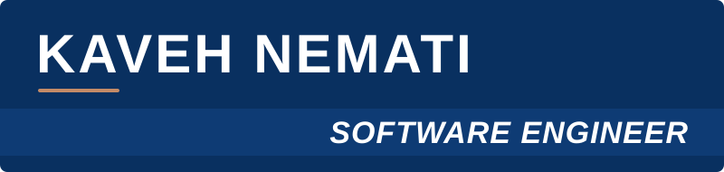

  <a href="mailto:kaavehnemati@gmail.com">kaavehnemati@gmail.com</a> 
  <a href="https://www.linkedin.com/in/kaveh-nemati-60415b20b/">LinkedIn</a> 
  Rasht, Iran

  
  
  
  
  
  

## PROFILE

Software Engineer with **3+ years** of hands-on experience designing, developing, deploying, and maintaining production applications. Strong background in backend engineering, software architecture, and cross-functional collaboration, with the ability to communicate effectively with team members, coordinate development workflows, support project management, and contribute to quality assurance throughout the software development lifecycle.

Experienced in **Python/FastAPI** and **PHP/Laravel**, working with **SQL and NoSQL** databases and applying architectural principles and patterns such as Domain-Driven Design (DDD), Modular Architecture, MVC, Microservices, and Inversion of Control (IoC). Focused on maintainable systems, reducing technical debt, and continuously improving software quality and development processes.

Experienced in AI engineering, including building applications and integrations using **LLM APIs** and leveraging AI coding agents such as **Claude Code** and **OpenAI Codex** for implementation, code review, debugging, refactoring, technical analysis, and development automation.

## WORK EXPERIENCE

###  PAYSTAR

**Software Engineer** &nbsp;  
Full-time · On-site · Rasht, Iran

Designing, developing, and maintaining production software applications and backend services using Python/FastAPI and PHP/Laravel. Contributing to software architecture, RESTful API development, authentication and authorization systems, and integrations with internal and external services. Working with SQL databases to implement business logic, improve performance, and maintain data integrity.

Collaborating closely with development teams on technical planning, code reviews, refactoring, and reducing technical debt. Involved in application deployment, infrastructure configuration, production troubleshooting, and improving system reliability and maintainability. Applying AI-assisted and agentic development workflows using Claude Code and OpenAI Codex to support implementation, debugging, technical analysis, and development efficiency.

###  AVINA IT SOLUTIONS

**Software Engineer** &nbsp;  
Part-time · Remote · Tehran, Iran

Designing, developing, and maintaining software applications using Python/FastAPI and PHP/Laravel, with responsibilities extending beyond backend implementation to software architecture, system design, code review, deployment, and production maintenance. Contributing to projects such as **Fanbazar**, involving data conversion and MongoDB integration, and **Helara**, developing LLM-powered application features using the Anthropic Claude API. Collaborating with development teams to improve code quality, reduce technical debt, and deliver scalable, maintainable software solutions.

**Back-end Developer** &nbsp; 
Full-time · Remote · Tehran, Iran

Developed and maintained backend applications using PHP/Laravel and MySQL, focusing on RESTful API development, authentication and authorization, business logic, database operations, and third-party integrations. Contributed to query optimization, debugging, refactoring, application deployment, and server-side configuration while collaborating with the development team to deliver reliable, maintainable production features.

###  PARDIS TECHNOLOGY PARK

**Quality Assurance Engineer** &nbsp; 
Full-time · Remote · Tehran, Iran

Worked closely with management and development teams on a daily basis to define and improve development workflows, establish QA processes, and select tools supporting project execution and product delivery. Conducted functional and API testing, developed automated tests using Cypress, and collaborated with developers to identify, track, and resolve issues. Contributed to release coordination, product quality, and successful delivery throughout the development lifecycle.

**Software Engineer Intern** &nbsp; 
Full-time · Remote · Tehran, Iran

Started with debugging and resolving issues in existing PHP/Laravel applications, gradually progressing to implementing backend features and contributing to RESTful API development. Gained hands-on experience with MySQL, authentication, and business logic before taking on greater responsibility in developing a Content Management System (CMS) from the ground up, contributing to its backend architecture, core functionality, and implementation.

## SKILLS

**Backend Engineering** 
<kbd>Python</kbd> <kbd>FastAPI</kbd> <kbd>PHP</kbd> <kbd>Laravel</kbd> 
Authentication & Authorization · Third-Party API & LLM API Integration · API Development · Business Logic Implementation

**Laravel Ecosystem** 
<kbd>Queues & Jobs</kbd> <kbd>Middleware</kbd> <kbd>Validation</kbd> <kbd>Eloquent ORM</kbd> <kbd>Sanctum</kbd> <kbd>Passport</kbd>

**Databases & Data** 
<kbd>PostgreSQL</kbd> <kbd>MySQL</kbd> <kbd>MongoDB</kbd> <kbd>Redis</kbd> 
Database Design · Data Modeling · Query Optimization

**Cloud & Infrastructure** 
<kbd>AWS</kbd> <kbd>EC2</kbd> <kbd>ECS</kbd> <kbd>Lambda</kbd> <kbd>API Gateway</kbd> <kbd>S3</kbd> <kbd>RDS</kbd> <kbd>IAM</kbd> <kbd>VPC</kbd> <kbd>CloudWatch</kbd> 
<kbd>Linux</kbd> <kbd>Ubuntu</kbd> <kbd>VPS</kbd> <kbd>Docker</kbd> <kbd>Terraform</kbd> <kbd>GitHub Actions</kbd> <kbd>GitLab CI/CD</kbd> 
Infrastructure as Code (IaC) · CI/CD Pipelines · Application Deployment · Server Configuration

**Testing & Quality** 
<kbd>Cypress</kbd> <kbd>Postman</kbd> <kbd>Hoppscotch</kbd> 
Automated, API, Functional & Regression Testing · Bug Analysis & Reporting

**Development Tools** 
<kbd>Git</kbd> <kbd>GitHub</kbd> <kbd>GitLab</kbd> <kbd>Composer</kbd> <kbd>DirectAdmin</kbd>

**AI-Assisted Engineering** 
<kbd>Claude Code</kbd> <kbd>OpenAI Codex</kbd> 
AI Coding Agents · Agentic Development Workflows · Technical Analysis · Development Automation

**Software Engineering** 
Software Design & Architecture · Object-Oriented Programming (OOP) · SOLID Principles · RESTful API Design · System Integration · DDD · Modular Architecture · MVC · Microservices · IoC · Code Review · Refactoring · Technical Debt Reduction

## EDUCATION

**B.Sc. Computer Engineering** 
*University of Guilan* 
2020 – 2024

